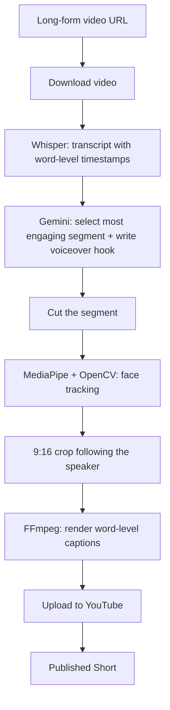

<div align="center">

# 🎬 TubeMationAI

### Turn any long video into a published YouTube Short, with zero manual steps

AI picks the best moment · tracks the face · adds captions · uploads for you


<!-- TODO: add a demo GIF showing URL in -> Short out. This matters more than anything else in this README. -->
<!--  -->

</div>

---

## 📌 Overview

Making Shorts from long videos by hand means finding the best part, cropping to vertical, adding captions and uploading. **TubeMationAI does all of that automatically.**

Give it a long-form video URL. It returns a **published YouTube Short**.

---

## ✨ Features

- 🧠 **AI segment selection:** Gemini reads the transcript and picks the most engaging segment
- 🎙️ **Voiceover hook:** Gemini writes a short hook for the opening
- 🙂 **Face tracking:** frame-by-frame tracking (MediaPipe + OpenCV) for a clean 9:16 crop
- 💬 **Word-level captions:** Whisper timestamps, rendered with FFmpeg
- 📤 **Automated upload:** the final Short is published to YouTube with no manual steps
- 🖥️ **Web interface:** Next.js frontend connected to a Python backend

---

## 🏗️ How It Works



---

## 🛠️ Tech Stack

| Layer | Tools |
|---|---|
| Frontend | Next.js |
| Backend | Python |
| LLM | Google Gemini API |
| Speech-to-text | OpenAI Whisper |
| Computer vision | OpenCV, MediaPipe |
| Video processing | FFmpeg |
| Publishing | YouTube upload automation |

---

## 🚀 Getting Started

> TODO: check these steps against your repo before publishing.

### Prerequisites
- Python 3.x
- Node.js 18+
- FFmpeg installed and on your PATH
- A Gemini API key
- YouTube API credentials (for auto-upload)

### Setup

```bash
git clone https://github.com/sopanhub/TubeMationAI.git
cd TubeMationAI

# Backend
pip install -r requirements.txt

# Frontend
cd frontend   # TODO: use your real folder name
npm install
npm run dev
```

### Environment variables

> TODO: replace with your real variable names.

| Variable | Purpose |
|---|---|
| `GEMINI_API_KEY` | Segment selection and hook writing |
| `YOUTUBE_*` | Authorised upload to your channel |

---

## 🎯 Usage

1. Open the web interface
2. Paste a long-form video URL
3. Start the pipeline
4. Get a published YouTube Short

---

## 🗺️ Roadmap

> TODO: keep only ideas you really plan to build.

- [ ] Multiple caption styles
- [ ] Batch processing
- [ ] Scheduling uploads

---

## ⚠️ Responsible Use

Only process videos you own or have permission to use. Follow YouTube's Terms of Service and the original creator's rights.

---

## 👤 Author

**Sopan Patil** · Full-Stack & AI Developer
[GitHub](https://github.com/sopanhub) · [LinkedIn](https://www.linkedin.com/in/sopan-patil-24b2a1380) · [patilsopan4148@gmail.com](mailto:patilsopan4148@gmail.com)
